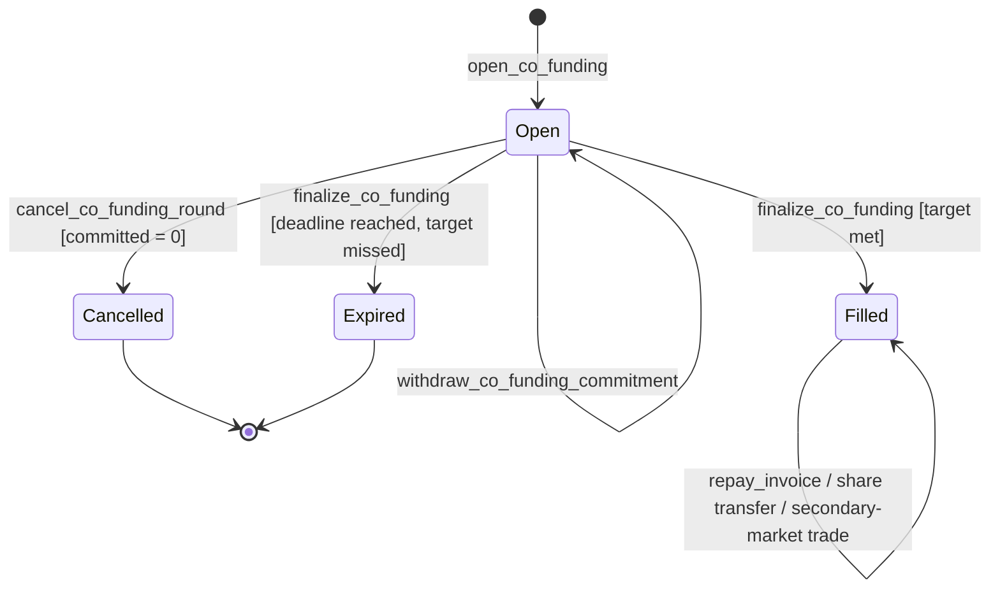

# Co-funding lifecycle, share accounting, and refunds

This guide describes the multi-investor co-funding implementation in
[`contracts/pool/src/lib.rs`](../contracts/pool/src/lib.rs), including its
refund, repayment, and secondary-market rules. Co-funding is distinct from
ordinary pool-driven invoice funding: investors commit value from existing
available pool positions, and the contract burns the corresponding pool
shares instead of keeping those shares outstanding against deployed capital.

## Lifecycle and states



The persisted `CoFundingStatus` values are `Open`, `Filled`, `Cancelled`,
and `Expired`. Full repayment does **not** change `Filled` to another
round status. The linked `FundedInvoice.repaid_amount` tracks repayment.

| Action | Caller / condition | Outcome |
| --- | --- | --- |
| `open_co_funding` | Admin; accepted token; unique invoice; future funding deadline | Creates an `Open` round with a target principal |
| `commit_to_invoice` | Investor; open round; before deadline; enough available pool shares | Burns pool shares, stores exact commitment and bps claim |
| `withdraw_co_funding_commitment` | Investor; open round; investor has a commitment | Re-credits the exact committed value as available pool shares; removes claim |
| `cancel_co_funding_round` | Admin; open round with **zero** committed principal | Marks `Cancelled`; performs no automatic refund |
| `finalize_co_funding` (filled) | Authorized caller; target principal reached | Marks `Filled`, creates funded invoice, sends principal to SME |
| `finalize_co_funding` (expired) | Authorized caller; deadline reached without full target | Refunds every exact commitment, clears participants, marks `Expired` |
| `transfer_co_fund_share` | Share owner; funded, not fully repaid | Transfers a portion of the holder's claim, updates participants |
| `market_settle_listing` | Authorized secondary-market contract | Transfers an absolute bps quantity of the invoice claim |

### Opening a round

The admin calls `open_co_funding` with the invoice ID, accepted token,
SME, positive target principal, invoice due date, future funding deadline,
minimum commitment, and per-investor cap. `min_commitment` can be zero;
`max_investor_bps = 0` disables the per-investor cap (otherwise values
cannot exceed 10,000 bps). A round cannot be opened for an invoice that
already has a co-funding round or funded record.

### Committing principal

`commit_to_invoice` caps the requested amount to the remaining target.
It converts the token amount into the pool's USDC-equivalent accounting
value using the configured exchange rate, burns the necessary pool shares,
reduces the investor's available position and `pool_value`, and records:

- `CoFundCommitted(invoice_id, investor)`: the **exact cumulative committed
  token amount**. This is the authoritative value for refunds.
- `CoFundShare(invoice_id, investor)`: an integer basis-point proportion
  of the **target principal**. Repeated commitments recalculate the share
  from the cumulative amount rather than summing rounded percentages.

```text
investor_share_bps = floor(investor_committed * 10_000 / target_principal)
```

The committed stablecoins remain in the pool contract, earmarked for the
round; they are transferred to the SME **only after successful finalization**.
The round's participant list is limited to 20 holders.

### Withdrawal, refunds, and cancellation

An investor can withdraw their commitment while the round remains `Open`.
`refund_co_funding_investor` reads the exact `CoFundCommitted` amount,
credits the value back into the investor's **available pool position**, and
removes the amount and share records. The refund mints pool shares at the
**current share valuation**; it is **not** a stablecoin transfer to the
investor's wallet, and the number of shares returned is not guaranteed to
equal the number initially burned.

The exact-amount rule matters: calculating refunds from truncated bps
would lose fractional portions of commitments. For example, a 333-token
commitment to a 1,000-token target gives 3,330 bps; arbitrary amounts
that do not divide cleanly into 10,000 bps are still refunded in full.

The admin can cancel an open round **only after its total committed
principal reaches zero**. It cannot cancel an active funded round to
bypass withdrawing and refunding commitments.

### Finalization

Once the target is met, `finalize_co_funding` creates a `FundedInvoice`,
locks the current funding rate, resolves the configured **factoring fee**
using the same `resolve_factoring_fee` function as ordinary pool funding
(including credit-score fee tiers), marks the round `Filled`, and pays the
committed principal to the SME. Because pool shares and NAV were already
reduced on commitment, it does **not** subtract the principal from
`pool_value` or add it to `total_deployed` a second time.

If the target was **not** met, finalization before the deadline is
rejected. Once the deadline has passed, finalization refunds every
participant's **exact** outstanding commitment, clears the participants
and committed total, marks `Expired`, and emits `cf_exp`. It does **not**
create a partially funded invoice or pay anything to the SME.

## Numeric example: bps, fee, and pari-passu repayments

Assume an invoice targeting **1,000 USDC**, a 1:1 token exchange rate,
a funding rate that produces **80 USDC interest** over the relevant
repayment period, and a **2.5% factoring fee** resolved at funding:

| Participant | Committed | Share of invoice | Principal + interest |
| --- | ---: | ---: | ---: |
| A | 500 | 5,000 bps (50%) | 540 |
| B | 300 | 3,000 bps (30%) | 324 |
| C | 200 | 2,000 bps (20%) | 216 |
| **Total** | **1,000** | **10,000 bps** | **1,080** |

The SME receives **1,000** at finalization and repays **1,105** in total:
1,000 principal + 80 interest + 25 factoring fee. The 25 fee is tracked
as protocol revenue, while the 1,080 principal-and-interest amount is
credited to co-funders proportionally to their then-current claim bps.
Referral rewards (if configured) are paid out of the factoring-fee path.

For **partial repayments**, the fee portion is allocated incrementally
against the fixed principal-plus-fee base using cumulative amounts; only
the remainder goes to co-funders. At full settlement, the recognized
factoring fee totals 25 and investor receipts total 1,080. Individual
partial payments may produce integer-rounding dust. The repayment
function floors each holder's proportional payment; the leftover
distribution dust is recorded in protocol revenue and pool value.

If the round had expired with only A's 500 and B's 300 committed,
they would instead be re-credited **exactly 500 and 300 of value** in
available pool shares; there would be no SME payout, interest, or fee.

## Share transfers and secondary-market settlement

Co-funding shares are tradeable **after the round is Filled**, subject to
authentication/KYC, repayment, and participant-limit checks. Claims are
transferred; neither the original committed amount nor past repayments
are transferred again.

`transfer_co_fund_share(from, invoice_id, token, to, bps)` accepts bps as
a **fraction of the sender's own current invoice share**:

```text
invoice_bps_transferred = floor(sender_invoice_bps * bps / 10_000)
```

For example, A owns 5,000 invoice bps; transferring 4,000 bps (40% of
A's holding) moves 2,000 invoice bps to the recipient, leaving A with
3,000. The contract updates `CoFundShare` and the round participant
list so future repayments follow the new owners.

The `market_settle_listing` co-funding branch is different:
`amount_or_bps` is the **absolute invoice bps** transferred from seller
to buyer, rather than a fraction of the seller's holding. This route
requires an authorized secondary-market contract and performs its own
balance, compliance, and participant-list checks.

## Repayment details and events

`repay_invoice` authenticates the SME, applies the interest rate locked
at funding, and caps the actual transfer to the outstanding amount due.
Co-funded repayments distribute principal and interest **pari-passu**:
each current holder is credited `floor(investor_payment * share_bps /
10_000)` to their available pool position. Credits mint shares at the
current pool valuation rather than transferring stablecoins immediately.
Full settlement decreases `active_funded_invoices`, but the round
remains `Filled`.

Key events in the lifecycle include `cf_open`, `cf_commit`,
`cf_wthdw`, `cf_cncl`, `cf_exp`, `cf_fin`, `funded`,
`shr_xfer`, `part_pay`, and `repaid`. Event topics use the pool's
`EVT` prefix; `cf_exp` includes the refunded total.
Record holders, exact commitments, and funded invoice state should be
queried on-chain for authoritative accounting rather than reconstructed
solely from rounded bps events.

## Related issues

- [#1745: document co-funding lifecycle and refunds](https://github.com/astera-hq/Astera/issues/1745)
- [#1746: charge factoring fees on co-funded invoices](https://github.com/astera-hq/Astera/issues/1746)
